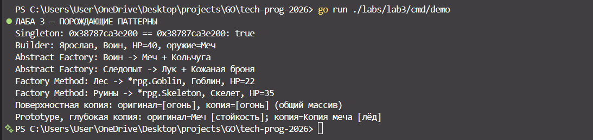
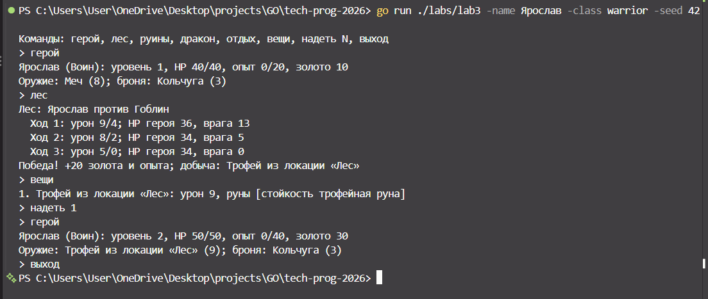

# Лабораторная работа 3 — порождающие паттерны

Спиридонов Ярослав Павлович, БИВТ-25-4-4

Небольшая текстовая RPG на Go. Герой ходит в экспедиции, сражается,
получает опыт и оружие. В лагере можно отдохнуть и сменить снаряжение.
Цель — победить дракона.

## Паттерны

| Паттерн | Пример в игре |
| --- | --- |
| Одиночка | `Dice()` возвращает один генератор случайных чисел |
| Строитель | `HeroBuilder` собирает героя и проверяет его характеристики |
| Фабричный метод | Локация создаёт своего противника через `CreateEnemy()` |
| Абстрактная фабрика | `WarriorKit` и `RangerKit` создают оружие и броню для разных классов |
| Прототип | `Weapon.Clone()` копирует оружие вместе со слайсом рун |

Реализации находятся в [rpg/creation.go](rpg/creation.go).

## Запуск

Нужен Go 1.22 или новее. Все команды выполняются из корня проекта.

Игра:

```sh
go run ./labs/laba03 -name Ярослав -class warrior -seed 42
```

Можно выбрать класс `ranger`. Параметр `-seed` позволяет повторить броски
при той же последовательности действий; его можно не указывать.

Демонстрация всех пяти паттернов и запуск тестов:

```sh
go run ./labs/laba03/cmd/demo
go test ./...
```

## Как играть

- `герой` — характеристики и снаряжение.
- `лес`, `руины`, `дракон` — отправиться в экспедицию.
- `отдых` — восстановить здоровье.
- `вещи` — посмотреть добытое оружие.
- `надеть 1` — обменять текущее оружие на первый предмет инвентаря.
- `выход` — завершить игру.

За победы герой получает опыт, золото и новое оружие. Бой с драконом открывается
на 3-м уровне. При поражении герой теряет половину золота. Сохранения между запусками нет.

## Скриншоты

Примеры запуска в терминале. Скриншоты сделаны до переименования папки;
актуальные команды запуска приведены выше.

Демонстрация паттернов:



Бой в лесу, получение добычи и смена оружия:


